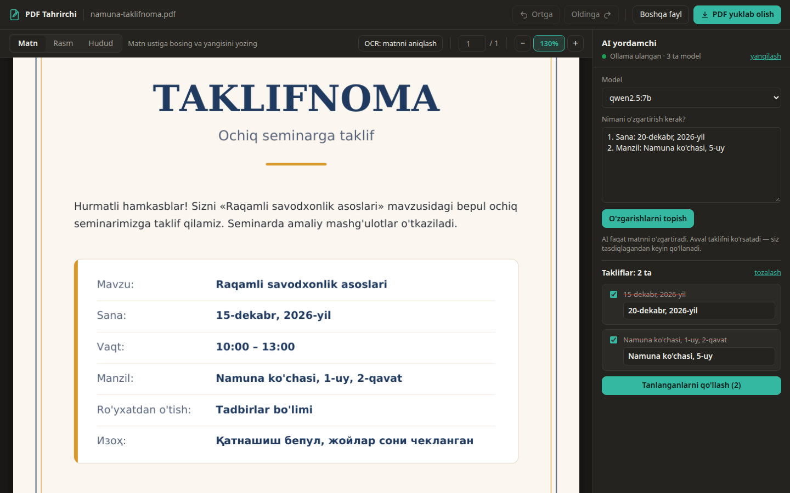

# PDF Tahrirchi

PDF fayldagi matn va rasmlarni brauzerda o'zgartiradigan **mahalliy** dastur.
Matn ustiga bosib yangisini yozasiz, rasmni almashtirasiz, skanerlangan sahifadagi
matnni OCR bilan topasiz yoki AI'ga «nimani o'zgartirish kerak»ligini oddiy so'z
bilan yozasiz — u o'zi topib, taklif qiladi.

Hammasi shu kompyuterda ishlaydi: fayllar internetga yuborilmaydi, pullik xizmat
va API kalit kerak emas.



## Imkoniyatlar

- **Matnni tahrirlash** — o'lcham, qalin/kursiv, rang, tekislash va shriftni o'zgartirish.
- **Rasmni almashtirish yoki o'chirish** — bir rasm bir nechta sahifada bo'lsa, hammasida almashadi.
- **Hudud** — to'rtburchak belgilab: matnni o'chirish, rang bilan yopish, yangi matn yoki rasm qo'yish.
- **OCR** — skanerlangan sahifa va rasm ichidagi matnni aniqlaydi (o'zbek lotin/kirill, rus, ingliz)
  va uni ham oddiy matndek tahrirlash mumkin bo'ladi.
- **AI yordamchi** — ko'rsatmani o'qib, qaysi matn nimaga almashishini taklif qiladi. Siz
  tasdiqlamaguningizcha hech narsa o'zgarmaydi.
- **Ortga / Oldinga** — oxirgi 40 ta o'zgarishgacha.
- **Ixcham natija** — yuklab olinadigan PDF'da shriftlardan faqat ishlatilgan belgilar qoladi.

## Qanday ishlaydi

1. **Matn.** Eski matn PDF ichidan haqiqatan o'chiriladi (redaction) — shunchaki ustidan
   yopilmaydi. Yangi matn asl shriftga eng o'xshash bepul shrift bilan, asl o'lcham va
   rangda yoziladi. Joyga sig'masa, shrift avtomatik kichrayadi.
2. **Skaner (OCR).** Tesseract sahifani tanib, har bir qatorni tahrirlanadigan elementga
   aylantiradi. Tahrirlanganda eski yozuv fon rangi bilan yopilib, ustiga yangisi yoziladi.
3. **AI.** Sahifadagi matnlar raqamlangan ro'yxat ko'rinishida Ollama'dagi modelga
   beriladi. Model PDF'ga tegmaydi — faqat «N-element → yangi matn» ko'rinishidagi
   takliflar qaytaradi. Ularni siz ko'rib, tuzatib, tasdiqlaysiz.

## Talablar

- **Docker** va **Docker Compose** (`docker compose` buyrug'i).
- **Ollama** (ixtiyoriy) — faqat AI yordamchi uchun. Usiz qo'lda tahrirlash va OCR to'liq ishlaydi.
- **RAM:** dastur o'zi ~200 MB; AI bilan — qo'shimcha ~5 GB (`qwen2.5:7b`).

## Ishga tushirish

```bash
cd pdf-tahrirchi
docker compose up -d --build
```

Birinchi marta 3–6 daqiqa vaqt oladi (OCR va shriftlar yuklab olinadi). Keyin brauzerda oching:

```
http://localhost:8080
```

Port faqat `127.0.0.1` ga ochilgan — dastur tarmoqdagi boshqa qurilmalardan ko'rinmaydi.

| Amal | Buyruq |
|---|---|
| To'xtatish | `docker compose down` |
| Qayta ishga tushirish | `docker compose up -d` |
| Kodni o'zgartirgandan keyin | `docker compose up -d --build` |
| Jurnalni ko'rish | `docker compose logs -f` |
| Butunlay o'chirish (yuklangan fayllar bilan) | `docker compose down -v` |
| Boshqa portda ochish | `PORT=9000 docker compose up -d` |

## Foydalanish

1. PDF faylni sahifaga tashlang yoki «Fayl tanlash»ni bosing.
2. Yuqoridagi rejimlardan birini tanlang:
   - **Matn** — matn ustiga bosing, yangisini yozing, Enter.
   - **Rasm** — rasm ustiga bosing va «Rasm tanlash…» orqali boshqasiga almashtiring yoki o'chiring.
   - **Hudud** — sichqoncha bilan to'rtburchak chizing: matnni o'chirish, rang bilan yopish,
     yangi matn yozish yoki rasm qo'yish.
3. **OCR** tugmasi — skanerlangan sahifa yoki rasm ichidagi matnni aniqlaydi. Aniqlangan
   matnlar punktir chiziq bilan ko'rsatiladi va ularni ham bosib o'zgartirish mumkin.
4. **AI yordamchi** (o'ng panel) — «Joriy sahifa» yoki «Butun hujjat»ni tanlang va nimani
   o'zgartirish kerakligini yozing, masalan:

   ```
   1. Sana: 20-dekabr, 2026-yil
   2. Manzil: Namuna ko'chasi, 5-uy
   ```

   «O'zgarishlarni topish»ni bosing. AI takliflar ro'yxatini chiqaradi; har birini ko'rib,
   kerak bo'lsa tuzatib, «Tanlanganlarni qo'llash»ni bosing.

   > Skanerlangan sahifada AI matnni ko'rishi uchun avval **OCR**'ni yoqing.

5. Xato bo'lsa — «Ortga». Tayyor bo'lgach — «PDF yuklab olish»
   (fayl `<nomi>-tahrirlangan.pdf` bo'lib saqlanadi).

Sahifani yangilasangiz yoki brauzerni qayta ochsangiz, oxirgi hujjat o'zi ochiladi.

### Klaviatura

| Tugma | Amal |
|---|---|
| `Ctrl+Z` | Ortga |
| `Ctrl+Y` yoki `Ctrl+Shift+Z` | Oldinga |
| `Enter` | Matnni saqlash («Matn» rejimida) |
| `Ctrl+Enter` | «Hudud»dagi yangi matnni saqlash (`Enter` — yangi qator) |
| `Ctrl+Enter` | AI panelida — o'zgarishlarni topish |
| `Esc` | Ochiq oynachani yopish |

## AI (Ollama) sozlash

### 1. Ollama va modelni o'rnatish

Ollama'ni [ollama.com/download](https://ollama.com/download) dan o'rnating
(Linux: `curl -fsSL https://ollama.com/install.sh | sh`), keyin modelni yuklab oling:

```bash
ollama pull qwen2.5:7b      # standart, ~5 GB RAM
ollama pull qwen2.5:14b     # ixtiyoriy: aniqroq, lekin sekinroq, ~10 GB RAM
```

Panelda Ollama'da o'rnatilgan barcha modellar chiqadi — kerakligini tanlaysiz.
Ish tugashi bilan model xotiradan chiqariladi.

### 2. Docker konteynerini Ollama'ga ulash (Linux)

Ollama odatda faqat `127.0.0.1` da tinglaydi, shuning uchun konteyner unga yeta olmaydi
(panelda «Ollama ulanmagan» chiqadi). Uni ochish uchun:

```bash
sudo systemctl edit ollama
```

Ochilgan faylga yozing va saqlang:

```ini
[Service]
Environment="OLLAMA_HOST=0.0.0.0"
```

```bash
sudo systemctl restart ollama
```

### 3. Tarmoq devori (ufw)

ufw yoqilgan bo'lsa, u konteynerdan kelgan so'rovlarni ham to'sadi (panelda ulanish
«timeout» bo'ladi). Faqat dastur konteyneri tarmog'iga ruxsat bering:

```bash
sudo ufw allow in on br-pdftahrir to any port 11434 proto tcp
```

`br-pdftahrir` — `docker-compose.yml` da belgilangan doimiy bridge nomi, shuning uchun bu qoida
konteyner qayta yaratilganda ham ishlayveradi.

> ⚠️ `ufw allow 11434` qilmang: u Ollama'ni (parolsiz) mahalliy tarmoqdagi hamma
> qurilmalarga ochib qo'yadi. Tarmoq devori umuman o'chiq bo'lsa ham `OLLAMA_HOST=0.0.0.0`
> xuddi shunday ta'sir qiladi — umumiy Wi-Fi'da ufw'ni yoqib qo'ying.

So'ng paneldagi «yangilash»ni bosing.

Ollama boshqa manzilda bo'lsa: `OLLAMA_URL=http://manzil:11434 docker compose up -d`.

## Sozlamalar

Quyidagilarni buyruq oldidan berish (`PORT=9000 docker compose up -d`) yoki loyiha
papkasidagi `.env` fayliga yozish mumkin — Docker Compose uni o'zi o'qiydi:

| O'zgaruvchi | Standart | Izoh |
|---|---|---|
| `PORT` | `8080` | Brauzerda ochiladigan port. |
| `OLLAMA_URL` | *(bo'sh)* | Ollama manzili. Bo'sh bo'lsa, dastur o'zi qidiradi: `host.docker.internal:11434` → `172.17.0.1:11434`. Vergul bilan bir nechtasini berish mumkin. |
| `OLLAMA_MODEL` | `qwen2.5:7b` | Panelda birinchi tanlanadigan model (o'rnatilgan bo'lsa). |
| `OLLAMA_NUM_THREAD` | `0` | Model ishlatadigan yadrolar soni. `0` — Ollama o'zi tanlaydi. |

Qolganlari `docker-compose.yml` dagi `environment` bo'limida o'zgartiriladi
(o'zgartirgach: `docker compose up -d`):

| O'zgaruvchi | Standart | Izoh |
|---|---|---|
| `OCR_LANGS` | `uzb+uzb_cyrl+rus+eng` | OCR tillari (Tesseract kodlari, `+` bilan). |
| `OCR_THREADS` | `2` | OCR ishlatadigan yadrolar soni. |
| `OCR_DPI` | `300` | OCR uchun sahifa sifati. Pastroq — tezroq, lekin xatoroq. |
| `OCR_TIMEOUT` | `180` | Bitta sahifa OCR'i uchun maksimal vaqt (soniya). |
| `OLLAMA_KEEP_ALIVE` | `2m` | Model so'rovdan keyin xotirada qancha turadi. |
| `OLLAMA_NUM_CTX` | `8192` | Model kontekst hajmi (token). |
| `OLLAMA_TIMEOUT` | `600` | AI javobini kutish vaqti (soniya). |
| `AI_BATCH_CHARS` | `3500` | «Butun hujjat»da modelga bir yo'la beriladigan matn hajmi (belgi). |
| `MAX_UPLOAD_MB` | `200` | Yuklanadigan PDF'ning maksimal hajmi (MB). |
| `MAX_HISTORY` | `40` | «Ortga» uchun saqlanadigan versiyalar soni. |
| `SESSION_TTL_DAYS` | `7` | Shundan eski hujjatlar konteyner ishga tushganda o'chiriladi. |

## Resurslar

- Konteyner: ko'pi bilan 1.5 GB RAM va 4 yadro (`docker-compose.yml` dagi `mem_limit` va `cpus`).
  Bo'sh turganda taxminan 100–200 MB.
- AI modeli Ollama ichida, konteynerdan tashqarida ishlaydi va faqat so'rov paytida yuklanadi.
  Protsessor yukini kamaytirish uchun: `OLLAMA_NUM_THREAD=8 docker compose up -d`.
- Yuklangan fayllar va ularning versiyalari Docker hajmida (`pdf-data`) saqlanadi.
  7 kundan eskilari konteyner har safar ishga tushganda o'chiriladi.

## Cheklovlar

- **Shrift.** Yangi matn asl shriftga eng o'xshash bepul shriftda yoziladi (DejaVu, Liberation,
  Carlito, Caladea). Asl shrift shulardan biri bo'lsa, farq bo'lmaydi; boshqa shriftlarda
  ozgina farq sezilishi mumkin.
- **Uzun matn.** PDF'da matn o'zi keyingi qatorga o'tmaydi. Yangi matn joyga sig'masa,
  shrift avtomatik kichrayadi (ko'pi bilan 60% gacha) va ogohlantirish chiqadi.
- **Skaner.** Skanerlangan matn aslida rasm: eski yozuv fon rangi bilan yopilib, ustiga yangisi
  yoziladi. Bir tekis fonda yaxshi chiqadi, naqshli fonda yopilgan joy sezilishi mumkin.
  OCR o'zbek kirill harflarida (ў, қ, ғ, ҳ) ba'zan xato qiladi — matnni tekshirib oling.
- **AI.** Faqat matnni o'zgartiradi (rasmni emas) va xato qilishi mumkin, shuning uchun
  o'zgarishlar tasdiqlashdan keyingina qo'llanadi.
- **Parolli PDF** ochilmaydi — avval parolini olib tashlang.
- Qiya yoki vertikal yozilgan matn tahrirlanmaydi (uni «Hudud» orqali yopib, qayta yozish mumkin).

## Muammolar

- **«Ollama ulanmagan»** — Ollama ishlab turganini tekshiring (`ollama list`), so'ng
  [Docker konteynerini Ollama'ga ulash](#2-docker-konteynerini-ollamaga-ulash-linux) va
  [ufw](#3-tarmoq-devori-ufw) bo'limlarini bajaring.
- **«Ollama ulangan, lekin model yo'q»** — modelni yuklab oling: `ollama pull qwen2.5:7b`.
- **«Model javob bermadi (vaqt tugadi)»** — kichikroq model tanlang yoki «Joriy sahifa»
  bilan ishlang. Kompyuter sekin bo'lsa, `OLLAMA_TIMEOUT` ni oshiring.
- **«Hujjatda matn topilmadi»** (AI'da) — sahifa skanerlangan: avval OCR'ni yoqing.
- **«Hujjat boshqa joyda o'zgargan»** — bitta hujjat ikki oynada ochiq. Sahifa o'zi
  yangilanadi, amalni qayta bajaring.
- **«Hujjat topilmadi (eskirgan bo'lishi mumkin)»** — hujjat 7 kundan eski bo'lgani uchun
  o'chirilgan. Faylni qayta yuklang.
- **«Fayl juda katta»** — chegarani `MAX_UPLOAD_MB` bilan oshiring.

## Texnologiyalar

[FastAPI](https://fastapi.tiangolo.com) ·
[PyMuPDF](https://github.com/pymupdf/PyMuPDF) (PDF) ·
[Tesseract](https://github.com/tesseract-ocr/tesseract) (OCR) ·
[Ollama](https://ollama.com) + Qwen2.5 (AI) ·
HTML/CSS/JS (tashqi kutubxonalarsiz) · Docker

## Tuzilma

```
pdf-tahrirchi/
├── app/
│   ├── main.py            # veb-server (FastAPI): API marshrutlari
│   ├── pdfcore.py         # PDF'ni o'qish va o'zgartirish (PyMuPDF)
│   ├── ocr.py             # OCR (Tesseract)
│   ├── ai.py              # Ollama bilan ishlash
│   ├── fonts.py           # asl shriftga mos bepul shriftni tanlash
│   ├── store.py           # hujjat versiyalari (ortga/oldinga)
│   └── static/            # veb-sahifa (index.html, app.js, style.css)
├── Dockerfile
├── docker-compose.yml
└── requirements.txt
```

## Mas'uliyat

- Dastur o'zingizga tegishli yoki tahrirlashga huquqingiz bor hujjatlar uchun mo'ljallangan.
  Rasmiy hujjatlarni (guvohnoma, diplom, ma'lumotnoma, shartnoma va h.k.) qalbakilashtirish
  qonunga zid — bunday foydalanish uchun javobgarlik to'liq foydalanuvchida.
- Dasturda login va parol yo'q: u faqat shu kompyuterda ishlatish uchun yozilgan.
  Uni internetga yoki umumiy tarmoqqa ochmang.
- Dastur «boricha» (as is), hech qanday kafolatsiz beriladi — [LICENSE](LICENSE) ning
  15–16-bandlariga qarang.

## Litsenziya

[GNU AGPL-3.0](LICENSE). Qisqacha:

- Dasturdan shaxsiy va tijoriy maqsadda bepul foydalanish va uni o'zgartirish mumkin.
- O'zgartirilgan versiyani tarqatsangiz **yoki serverga qo'yib boshqalarga xizmat sifatida
  bersangiz**, uning manba kodini ham AGPL-3.0 ostida ochishingiz shart.

AGPL tanlanganining sababi — dastur [PyMuPDF](https://github.com/pymupdf/PyMuPDF)
kutubxonasiga asoslangan, u ham AGPL-3.0 litsenziyasida.
